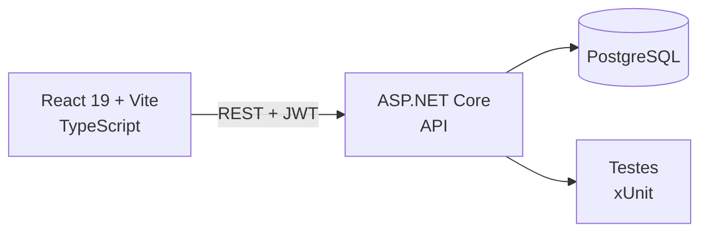

<!--
  SHOWCASE PRIVADO — apenas documentação; nenhum código-fonte.
  Quando as capturas existirem, salvar em docs/screens/ e descomentar a seção de demonstração.
-->

# Nappa Agenda

**Agenda digital da clínica multidisciplinar NAPPA (UNIFESO): pacientes, profissionais e horários em um fluxo único.**

> **Nota:** o código-fonte é mantido em repositório **privado**. Este repositório publica apenas a documentação do produto e da arquitetura, para fins de portfólio.

---

## 📌 O problema

A clínica multidisciplinar **NAPPA** da UNIFESO recebe pacientes de várias especialidades — psicologia, pedagogia, fonoaudiologia — e o agendamento era controlado manualmente. Isso gera conflito de horários, fila de espera opaca e dificuldade de enxergar a ocupação dos profissionais.

O sistema digitaliza o fluxo completo: cadastro de pacientes, agenda por profissional, controle de disponibilidade e acompanhamento dos atendimentos.

---

## ✨ Funcionalidades

- Autenticação com **JWT** e perfis distintos de acesso
- Cadastro e gestão de pacientes
- Agenda por profissional, com controle de disponibilidade
- Visualização de horários e organização do fluxo de atendimento
- API REST documentada
- Monorepo com backend, frontend e testes automatizados

---

## 🏗️ Arquitetura

**Backend (camadas):** `NAPPA.Api` · `NAPPA.Application` · `NAPPA.Domain` · `NAPPA.Infrastructure` · `NAPPA.Api.Tests`
**Frontend:** React 19 · Vite · TypeScript · React Router · Axios · Lucide

---

## 🧰 Stack

| Área | Tecnologia |
|---|---|
| Backend | C# · .NET 9 · ASP.NET Core |
| Frontend | React 19 · Vite · TypeScript |
| Banco | PostgreSQL |
| Autenticação | JWT |
| Infra local | Docker Compose |
| Testes | xUnit (controllers e services) |

---

## 🧠 Decisões técnicas

- **Monorepo** — frontend e backend evoluem juntos, com um único histórico de decisões.
- **Camadas explícitas no backend** — Api, Application, Domain e Infrastructure separadas, com testes por camada.
- **JWT + perfis** — permissões diferentes para paciente, profissional e administração.
- **Docker Compose** — banco e API sobem com um comando; credenciais por variável de ambiente.

---

<!-- DEMONSTRAÇÃO (descomentar quando houver mídia em docs/screens/):
## 📸 Demonstração

| Fluxo | Mídia |
|---|---|
| Login | `docs/screens/login.png` |
| Agenda por profissional | `docs/screens/agenda.png` |
| Novo agendamento | `docs/screens/novo-agendamento.png` |
| Meus agendamentos | `docs/screens/meus-agendamentos.png` |
-->

## 👥 Equipe

- **Eduardo Leal** — [@dudu4leal](https://github.com/dudu4leal)
- **Yuri Domingues** — [@yuridomingues](https://github.com/yuridomingues)
- **Anna Pitzer** — [@Anna-Pitzer](https://github.com/Anna-Pitzer)
- **Erick Lopes dos Santos Carvalho** — [@ErickLopesSC](https://github.com/ErickLopesSC)

**Showcase mantido por** Erick Lopes — [LinkedIn](https://www.linkedin.com/in/erick-lopes-2k02/)
